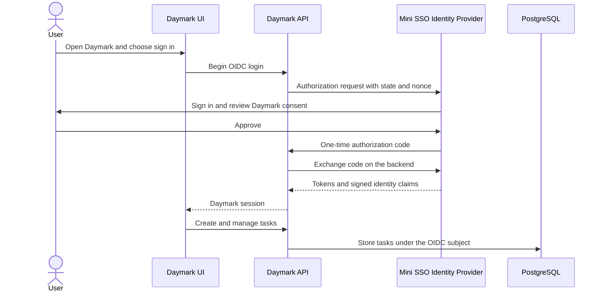

# Mini SSO + Daymark

An educational full-stack project: a separate OpenID Connect Identity Provider signs a user into **Daymark**, a personal task manager. Daymark never asks for or stores the user's password. The DLP Scanner is a possible future second client; it is not built yet.

## Sign-in flow



## Stack

- Mini SSO Identity Provider: Flask, Authlib, PostgreSQL.
- Daymark client API: FastAPI, Authlib, SQLAlchemy, PostgreSQL (or SQLite for local fallback).
- Daymark UI: React, TypeScript, Vite, responsive CSS.

## Run locally (PowerShell)

From the project root, copy the example configuration and replace placeholder secrets:

```powershell
Copy-Item .env.example .env
Copy-Item web/.env.example web/.env
```

Start PostgreSQL if Docker Desktop is available, then prepare Python and JavaScript dependencies:

```powershell
docker compose up -d db
py -m venv .venv
.\.venv\Scripts\Activate.ps1
py -m pip install -r idp\requirements.txt
py -m pip install -r daymark\requirements.txt
Set-Location web
npm install
Set-Location ..
```

If Docker is unavailable, edit `.env` to use SQLite for both services:

```text
DATABASE_URL=sqlite:///minisso-local.db
DAYMARK_DATABASE_URL=sqlite:///./daymark.db
```

Open three PowerShell terminals from the project root.

**Terminal 1 — Identity Provider**

```powershell
Set-Location idp
..\.venv\Scripts\Activate.ps1
flask --app app initdb
flask --app app run --port 5002
```

**Terminal 2 — Daymark API**

```powershell
.\.venv\Scripts\Activate.ps1
uvicorn main:app --app-dir daymark --reload --port 8101 --env-file .env
```

**Terminal 3 — Daymark UI**

```powershell
Set-Location web
npm run dev -- --port 5174 --strictPort
```

Open [http://localhost:5174](http://localhost:5174), choose **Open Daymark**, then register a disposable demo account at Mini SSO.

The local ports are set to 5002, 8101, and 5174 to avoid conflicts with older demo processes. If you change them, keep the Identity Provider issuer, Daymark URL, registered callback, logout redirect, and frontend API URL in sync before running `flask initdb`.

## Daymark features

- Inbox, Today, Upcoming, All Tasks, and Completed views.
- Quick-add tasks and a full task editor with notes, priorities, start/due dates, projects, and user-defined tags.
- Create projects with a chosen accent color.
- Search, priority filter, task completion/reopening, edit, and delete.
- Preferences for light/dark appearance, comfortable/compact density, week start, and date format.
- Authenticated task and project data is scoped to the stable OIDC subject. The API checks ownership on each operation.

## Security choices and limitations

- Authlib handles OIDC state/nonce and the backend authorization-code exchange for the Daymark client.
- The Identity Provider requires exact callback registration. Daymark's client secret remains backend-only.
- Task write requests require a session-bound CSRF token. The CORS allowlist is restricted to the configured UI origin.
- Session cookies are HttpOnly and SameSite=Lax; enable Secure when using HTTPS.
- SQLite is only a convenient local fallback. Use PostgreSQL for a shared deployment.
- This project is for learning with disposable test accounts. It is not production-ready identity or task software. It still needs an independent security review, database migrations, robust key rotation, operational monitoring, tested backups, rate limits, and production deployment configuration.
- Recurring tasks, reminders, native calendar integration, file attachments, collaboration, and the DLP Scanner are future work, not current features.

## Tests

```powershell
.\.venv\Scripts\python.exe -m pytest -q
```

The tests cover Identity Provider behavior, Daymark task CRUD, date validation, authentication requirements, and isolation between OIDC users.
